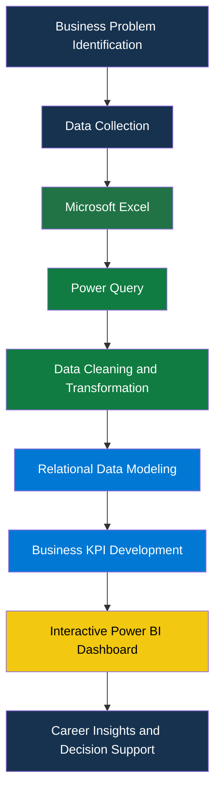
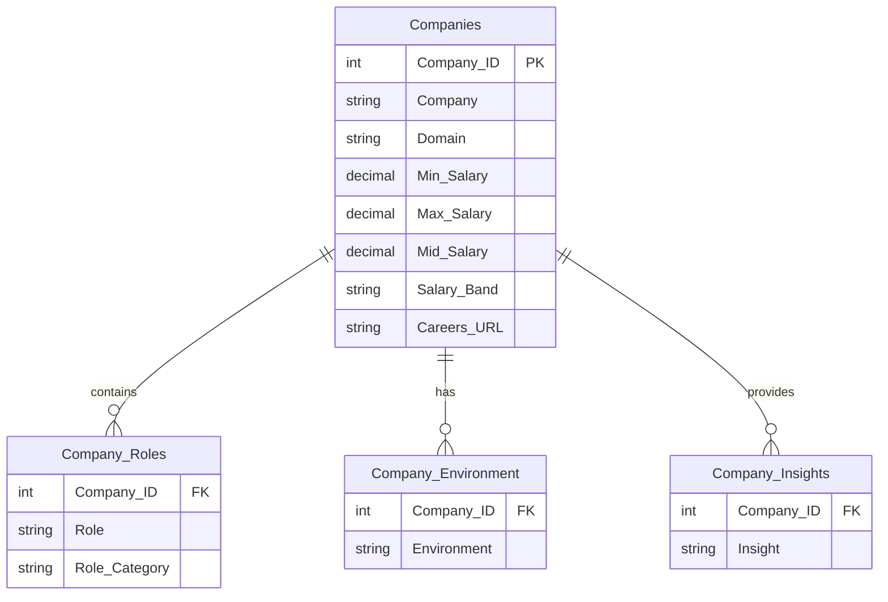

# Fresher Career Intelligence Dashboard


## Project Overview

The Fresher Career Intelligence Dashboard is an interactive
business intelligence solution designed to help fresh graduates
make informed career decisions.

The project analyzes career-related information from 50 companies
across different industries, providing insights into job roles,
estimated salary packages, work environments, and company-specific
career information.

The dashboard transforms unstructured career information into
meaningful and actionable insights through data cleaning,
transformation, relational data modeling, and interactive
data visualization.

## Business Problem

Fresh graduates entering the job market face several challenges
when searching for suitable career opportunities.

- Career information is scattered across multiple platforms.
- Freshers struggle to identify companies offering relevant
  analyst roles.
- Salary expectations are often unclear.
- Comparing companies across different industries is difficult.
- Candidates have limited information about workplace environments.
- Finding official company career websites requires additional effort.
- There is no single platform within the scope of this project
  that consolidates all the collected career information.

These challenges make career exploration time-consuming and
make it difficult for candidates to make informed decisions.

## Proposed Solution

To address these challenges, an interactive Power BI dashboard
was developed to consolidate company-level career information
into a centralized analytical platform.

The solution enables users to:

- Explore career information across 50 companies.
- Compare estimated fresher salary packages.
- Identify companies associated with Data Analyst and BI Analyst roles.
- Analyze industry-wise career opportunities.
- Understand company work environments.
- Explore company-specific information.
- Navigate directly to official company career websites.

The dashboard simplifies career research through interactive
filters, dynamic visualizations, and company-level insights.

## Business Questions

1. Which companies offer relevant fresher-level analyst roles?
2. Which companies provide higher estimated salary packages?
3. Which industries offer relevant career opportunities?
4. What are the common work environments across companies?
5. What are the estimated salary ranges for fresh graduates?
6. What should candidates know before applying to a company?
7. Where can candidates access official career websites?

## Dataset Overview

| Attribute | Description |
|-----------|-------------|
| Company | Name of the organization |
| Domain | Industry or business sector |
| Fresher Role | Typical entry-level job roles |
| Minimum Salary | Lower estimated salary range |
| Maximum Salary | Upper estimated salary range |
| Average Package | Midpoint of the estimated salary range |
| Work Environment | Workplace characteristics |
| Company Insights | Important career-related information |
| Careers URL | Official company career website |

The dataset contains information about 50 companies across
multiple business domains.

Salary values are represented in Lakhs Per Annum (LPA).

## End-to-End Project Workflow



## Project Implementation

### 1. Data Collection

Company-level career information was collected and organized
using Microsoft Excel.

The dataset includes company names, business domains, typical
fresher roles, estimated salary ranges, workplace characteristics,
company insights, and official career website links.

### 2. Data Cleaning and Transformation

Power Query was used to transform the collected information
into a structured dataset suitable for analysis.

The transformation process included:

- Removing unnecessary symbols and spaces.
- Standardizing company and industry names.
- Converting salary information into numerical values.
- Separating minimum and maximum salary ranges.
- Calculating estimated midpoint salary values.
- Categorizing salary ranges.
- Separating multiple job roles into individual records.
- Structuring work environment information.
- Separating company-specific insights.
- Creating unique company identifiers.

These transformations improved data consistency and prepared
the dataset for effective relational modeling.

### 3. Data Modeling

A relational data model was developed to manage company
information and multiple associated attributes.

The central Companies table contains company-level information,
while supporting tables store individual job roles, work
environment attributes, and company insights.

This approach reduces unnecessary data duplication and
supports interactive filtering across the dashboard.

## Data Model Architecture



### Data Model Explanation

| Table | Purpose |
|-------|---------|
| Companies | Stores company-level information and salary attributes |
| Company_Roles | Stores multiple job roles associated with companies |
| Company_Environment | Stores individual workplace characteristics |
| Company_Insights | Stores company-specific career information |

All supporting tables are connected to the Companies table
using Company_ID through one-to-many relationships.

This model allows a single company to have multiple job roles,
workplace characteristics, and career insights without
duplicating company-level salary information.

### 4. Business KPI Development

Business KPIs were developed to provide a consolidated
understanding of the collected career information.

The primary KPIs include:

- Total Companies
- Data Analyst Companies
- Estimated Average Package
- Highest Package
- Minimum Salary
- Maximum Salary

These indicators respond to relevant dashboard filters,
allowing users to explore different segments of the dataset.

### 5. Data Visualization

Power BI was used to convert the prepared dataset into an
interactive and visually engaging dashboard.

The dashboard combines KPI cards, bar charts, column charts,
donut charts, slicers, navigation buttons, and dynamic
company-level information.

A corporate-themed design was implemented to maintain
a professional and consistent user experience.

## Dashboard Overview

The dashboard consists of three interactive pages.

### Page 1 — Welcome

The Welcome page serves as the entry point to the dashboard.

It introduces the project and provides navigation to the
Career Overview and Company Explorer pages.

Key features:

- Professional corporate-themed interface
- Project introduction
- Interactive page navigation
- Career information disclaimer


### Page 2 — Career Overview

The Career Overview page provides a consolidated analytical
view of companies, salary ranges, industries, job roles,
and work environments.

Users can compare companies and identify relevant career
information through interactive visualizations.

Key features:

- Total Companies
- Data Analyst Companies
- Estimated Average Package
- Highest Package
- Top Paying Companies
- Fresher Role Distribution
- Work Environment Distribution
- Companies by Domain
- Interactive slicers
- Reset Filters functionality


### Page 3 — Company Explorer

The Company Explorer page provides detailed information
about an individual company.

When a user selects a company, the relevant salary information,
job roles, workplace characteristics, and career insights
are displayed dynamically.

Key features:

- Company selection
- Minimum and maximum salary
- Estimated average package
- Industry information
- Typical fresher roles
- Work environment
- Important company insights
- Dynamic official careers website button

This page connects analytical insights with practical
career exploration by allowing users to visit the selected
company's official career website.


## Project Structure

```text
Fresher-Career-Intelligence-Dashboard/
│
├── README.md
│
├── data/
│   └── Fresher_Company_Data.xlsx
│
├── dashboard/
│   └── Fresher_Career_Intelligence_Dashboard.pbix
│
├── screenshots/
│   ├── welcome.png
│   ├── career-overview.png
│   └── company-explorer.png
│
└── documentation/
    ├── Fresher_Career_Intelligence_BRD.pdf
    ├── Fresher_Career_Intelligence_FRD.pdf
    └── Fresher_Career_Intelligence_Data_Dictionary.pdf
```

## Project Documentation

| Document | Description |
|----------|-------------|
| [BRD](documentation/Fresher_Career_Intelligence_BRD.pdf) | Business objectives, requirements and project scope |
| [FRD](documentation/Fresher_Career_Intelligence_FRD.pdf) | Dashboard functionality and user interaction requirements |
| [Data Dictionary](documentation/Fresher_Career_Intelligence_Data_Dictionary.pdf) | Dataset structure, attributes and relationships |

## Business Impact

The dashboard is designed to deliver the following benefits:

- Reduce the effort required to research companies.
- Improve awareness of fresher-level career opportunities.
- Support informed salary expectations.
- Simplify company and industry comparisons.
- Improve accessibility to official career websites.
- Support data-driven career planning.

The project demonstrates how business intelligence can be
applied to a real-world career exploration problem.

## Skills Demonstrated

- Business Problem Identification
- Business Requirements Analysis
- Data Collection
- Data Cleaning and Transformation
- Microsoft Excel
- Power Query
- Relational Data Modeling
- Business KPI Development
- Power BI Dashboard Development
- Data Visualization
- Data Storytelling
- Technical Documentation

## How to Access the Dashboard

1. Download the Power BI file from the dashboard folder.
2. Install Microsoft Power BI Desktop.
3. Open the PBIX file.
4. Explore the dashboard using interactive filters.
5. Use Ctrl + Click to access navigation buttons in Desktop.

[Download Power BI Desktop](https://powerbi.microsoft.com/desktop/)

## Future Enhancements

- Expand the dataset to include more companies.
- Integrate verified job vacancy information.
- Introduce location-based career analysis.
- Analyze industry-specific skill requirements.
- Add interview preparation resources.
- Automate data collection and refresh.
- Enable public interactive dashboard access.

## Disclaimer

This project is developed for educational and career
guidance purposes.

Salary ranges, job roles, and work environment information
are indicative and may change over time.

The dashboard does not guarantee employment opportunities
or active job vacancies.

Users should verify information through official company
career websites before making career decisions.

Company names and logos belong to their respective owners.

## Author

**Ammuturi Manikanta**

MSc Data Science  
Dayananda Sagar University, Bengaluru

Aspiring Data Analyst | Power BI Developer

---

**Transforming career data into meaningful insights for fresh graduates.**
